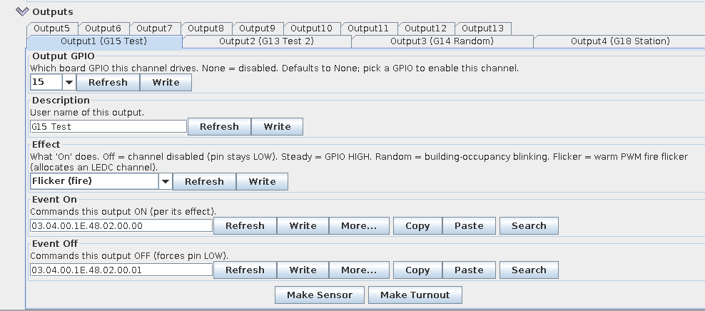

# lcc-out-node

An LCC / OpenLCB node with **13 outputs** for lighting and effects, on a classic
**ESP32 DevKit** with a CAN transceiver. Built with **OpenMRNLite** and set up
entirely from JMRI.

Each output has:

- a **GPIO** chosen from a dropdown (or None to leave it unused),
- an **effect**:
  - **Steady** – on/off,
  - **Random** – building lights: on for a random 20 s – 4 min, off for 10 s – 2 min,
    each output independently,
  - **Flicker** – a warm fire flicker (PWM, never fully dark),
  - **Off** – channel disabled,
- an **On** and an **Off** event, and a description.

Changes made in JMRI apply straight away – no reboot – and are saved to flash.
At start-up the node asks the network for each output's current state, so it
comes back as JMRI left it.

## Hardware

- **ESP32 DevKit** (classic ESP32, WROOM or WROVER).
- A **3.3 V CAN transceiver** – an SN65HVD230 module, or my
  [LCC interface board](https://github.com/honzup/LCC_Interface_KiCad) with
  RJ45s. CAN runs at 125 kbit/s.

| ESP32 | Transceiver |
|-------|-------------|
| GPIO5 | TX (TXD / D) |
| GPIO4 | RX (RXD / R) |
| 3V3   | 3.3 V |
| GND   | GND |

**Output GPIOs** offered in the dropdown: 13, 14, 15, 18, 19, 21, 22, 23, 25, 26,
27, 32, 33. GPIO2 is the on-board LED, used to show WiFi status.

An ESP32 pin gives 3.3 V and only a few milliamps comfortably. LEDs with a
suitable series resistor are fine; for anything bigger (lamps, strips, many LEDs)
drive a transistor, MOSFET or a ULN2803 from the pin.

## Build and install

Uses PlatformIO with `espressif32@6.9.0` (arduino-esp32 2.0.x) and
**OpenMRNLite v2.0.0**. Don't move to OpenMRNLite 2.2.x without changing the
code – it removes the `Esp32HardwareTwai` CAN driver used here.

1. **Set the node ID** at the top of `src/main.cpp` (the "SET THIS FOR YOUR
   LAYOUT" block). The one in the file is mine; two nodes with the same ID break
   the network. MERG members: `03.04.00.<membership number in hex>.<nn>`;
   otherwise get a free range from OpenLCB.
2. **Flash over USB:**
   ```bash
   pio run -e esp32_omrn -t upload
   ```
3. Connect the CAN bus. The node appears in JMRI under **OpenLCB → Open LccPro**
   (or **Configure Nodes**) as "13-Output Effects (OpenMRNLite)".
4. **Configure each output** in the node's configuration: pick its GPIO and
   effect, then add a description. All outputs start as None / Off, so nothing
   is driven until you set them up.

   

5. **Control it from JMRI** with the output's On and Off events – for example a
   JMRI OpenLCB **Light** or **Turnout** using those two events, or from LogixNG.

## WiFi and OTA updates

WiFi is **off** in normal running, so the CAN side never depends on it. Two
LCC events switch it on and off:

| Event | Action |
|-------|--------|
| `<node id>.FE.00` | WiFi on |
| `<node id>.FE.01` | WiFi off |

Create a JMRI OpenLCB sensor or turnout with those two events to get a WiFi
switch; it follows the node's real state, including after a reboot.

The first time WiFi is switched on, the node opens an access point called
**`LCC-Out-Setup`** for 3 minutes – connect from a phone and enter your WiFi
details. With WiFi on, the on-board LED lights and OTA is available:

```bash
pio run -e esp32_omrn_ota -t upload --upload-port <node-ip>
```

Use the IP address (the node also advertises `lcc-out-node.local`, but mDNS
isn't reliable everywhere). OTA has **no password** – switch WiFi off again when
you've finished.

## Notes

- If you change the configuration layout in `src/config.h`, bump
  `CANONICAL_VERSION`. The stored configuration is then reset to defaults
  instead of being read against the wrong layout. Restart JMRI afterwards too,
  as it caches each node's CDI.
- The CAN receive buffer is enlarged (`can_rx_buffer_size` 128) so long
  configuration writes from JMRI aren't truncated.

## Licence

BSD 2-clause – see `LICENSE`. Based on the ESP32IOBoard example from
OpenMRNLite by Mike Dunston.
